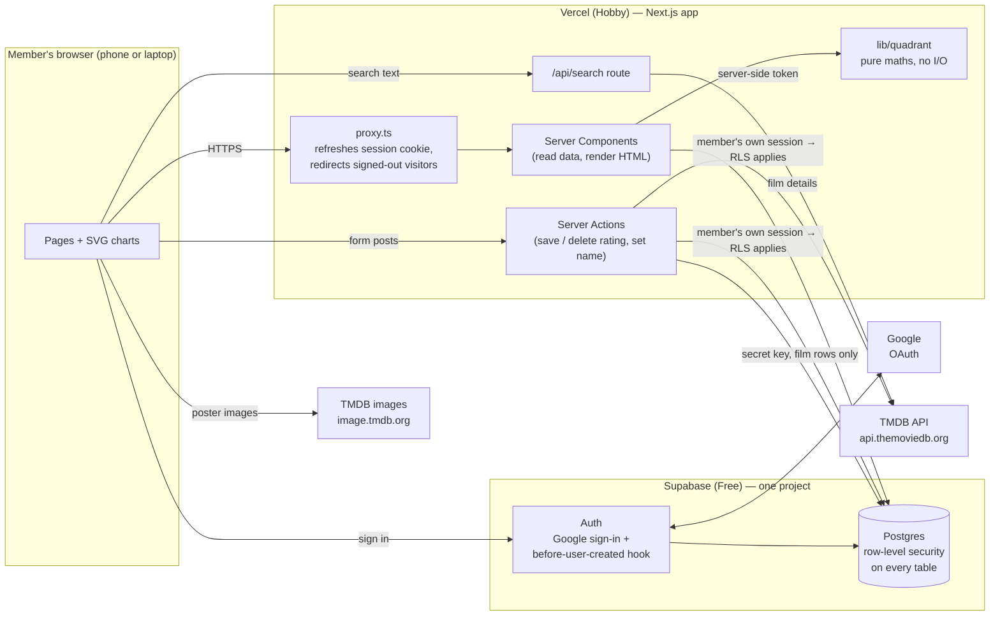
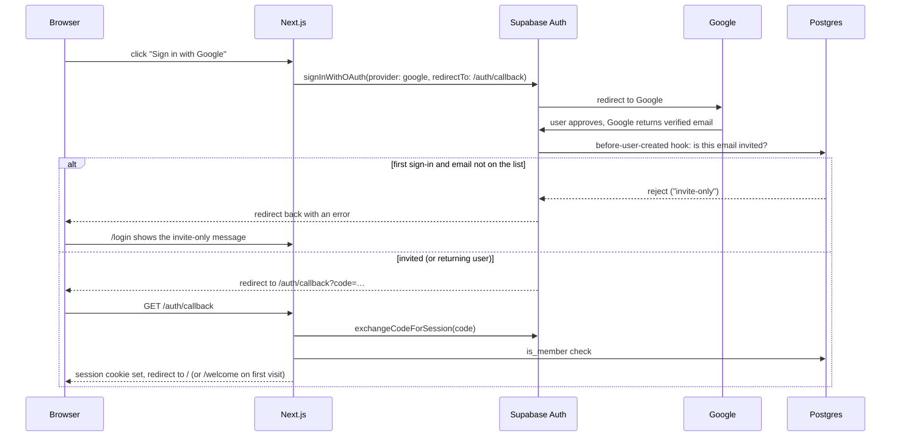

# 02 — Design

Status: **APPROVED** (amended version, 2026-11-14) — §7 and
§8 now have thirteen placements (outer corners need both scores at 7.5+ / 2.5−;
inner bands fill the rest of each quarter), following requirements v4.
Implements: `01-requirements.md` (approved v2)

**Section 16 (the design for requirements v6) was approved by the owner on
2026-11-15.**

Every section lists the requirement IDs it satisfies. Section 14 is the reverse
lookup (requirement → section). Section 15 lists facts I could **not** confirm
from documentation and that must be checked with a real call before the code
that depends on them is written (CLAUDE.md: "never invent API response shapes").

---

## 1. Architecture overview

_Satisfies: R5, R47, R48, NFR1–NFR4, NFR11_

One Next.js application, deployed on Vercel, talking to one Supabase project
(Postgres database + authentication) and to the TMDB movie API.



The three ideas that matter:

1. **The database is the security boundary.** Every query made on behalf of a
   member is made _as_ that member, so Postgres row-level security (RLS) decides
   what they can see and change. The Next.js code adds friendlier errors and
   redirects, but if all of it were deleted the data would still be protected.
2. **All maths lives in one pure module** (`lib/quadrant`). Pages fetch plain
   rows and hand them to pure functions. Nothing about quadrants, averages or
   disagreement is computed in SQL or inside a component.
3. **TMDB is only ever called from the server**, so its token never reaches a
   browser, and rated films are copied into our own database so the app works
   when TMDB doesn't.

---

## 2. Tech stack and rejected alternatives

_Satisfies: NFR11, NFR16, brief constraint "boring, well-documented tools"_

Versions are the current stable releases on npm on 2026-11-14, except
TypeScript: `create-next-app` installs TypeScript 5, and we keep what the
framework ships with rather than jumping a major version ahead of it.

| Area                     | Choice                                     | Why                                                                                                                                                                                                                                    | Rejected, and why                                                                                                                                                                                                                                                                                                      |
| ------------------------ | ------------------------------------------ | -------------------------------------------------------------------------------------------------------------------------------------------------------------------------------------------------------------------------------------- | ---------------------------------------------------------------------------------------------------------------------------------------------------------------------------------------------------------------------------------------------------------------------------------------------------------------------- |
| Language                 | **TypeScript** 5 (strict)                  | Required by NFR16; catches whole classes of mistakes before running.                                                                                                                                                                   | Plain JavaScript — no types.                                                                                                                                                                                                                                                                                           |
| Web framework            | **Next.js 16** (App Router) + React 19     | Most widely documented React framework; gives pages _and_ server code in one project, which we need to keep the TMDB token and the Supabase secret key off the browser. Supabase's own auth guide targets it directly.                 | **Vite single-page app** calling Supabase from the browser — simpler, but has no server, so the TMDB token would need a separate serverless function anyway. **SvelteKit / Remix** — fine tools, smaller body of tutorials and examples to learn from.                                                                 |
| Database + auth          | **Supabase** (Postgres)                    | A real relational database with RLS tied directly to the signed-in user, Google sign-in built in, and a free tier. One service covers must-haves 1 and 6.                                                                              | **Firebase** — document database; "average of all ratings per film" and "one rating per member per film" are awkward without SQL, and its security rules are a separate language to learn. **Neon Postgres + Auth.js** — two services to wire together, and RLS would not know who the user is without extra plumbing. |
| Database access          | **supabase-js** with generated types       | Queries run with the member's session so RLS applies automatically.                                                                                                                                                                    | **Prisma / Drizzle** — they connect as the database owner, which _bypasses RLS_; access control would then live only in our code, breaking NFR1.                                                                                                                                                                       |
| Hosting                  | **Vercel Hobby**                           | Built by the Next.js team; deploy on every git push; free.                                                                                                                                                                             | **Netlify / Cloudflare Pages** — both work, but Next.js features lag behind or need adapters.                                                                                                                                                                                                                          |
| Movie data               | **TMDB API v3**                            | Free for non-commercial use, good search, posters.                                                                                                                                                                                     | **OMDb** — from memory it has a low daily request cap and weaker title search; not re-verified because TMDB met every need.                                                                                                                                                                                            |
| Charts                   | **Hand-written SVG** React components      | Our chart is a 0–10 grid with dots, two lines and some spokes. Writing it ourselves is ~150 readable lines, gives full control over keyboard access and the "several films on one spot" rule (R31), and is a better learning exercise. | **Recharts** — quick for a standard scatter plot, but spokes, clusters and on-the-line points mean fighting the library. **D3** — powerful, but a large API to learn for one simple chart.                                                                                                                             |
| Styling                  | **Tailwind CSS 4**                         | The default in `create-next-app`; no naming of CSS classes; heavily documented.                                                                                                                                                        | **CSS Modules** — fine, but more files and more decisions. A component library (MUI, shadcn) — more than a POC needs.                                                                                                                                                                                                  |
| Input validation         | **Zod 4**                                  | One schema gives both a runtime check and a TypeScript type.                                                                                                                                                                           | Hand-written `if` checks — easy to let the check and the type drift apart.                                                                                                                                                                                                                                             |
| Unit / integration tests | **Vitest 5**                               | Fast, TypeScript without setup, Jest-compatible API.                                                                                                                                                                                   | **Jest** — needs extra configuration for TypeScript and ES modules.                                                                                                                                                                                                                                                    |
| End-to-end tests         | **Playwright**                             | Drives a real browser; first-class docs.                                                                                                                                                                                               | **Cypress** — comparable; Playwright handles saved sign-in state more simply.                                                                                                                                                                                                                                          |
| Lint / format            | **ESLint** (Next.js config) + **Prettier** | The defaults.                                                                                                                                                                                                                          | —                                                                                                                                                                                                                                                                                                                      |
| Package manager          | **npm**                                    | Ships with Node; nothing extra to install.                                                                                                                                                                                             | pnpm / yarn — no benefit at this size.                                                                                                                                                                                                                                                                                 |

---

## 3. Data model

_Satisfies: R5, R6, R14–R22, R47, NFR1, NFR5, NFR19–NFR21_

Four tables in the `public` schema plus one helper function in a `private`
schema. All tables have RLS **enabled**; a table with RLS enabled and no
matching policy returns nothing, so the default is "deny".

### 3.1 `allowed_emails` — the invite list

| Column     | Type          | Constraints                                 |
| ---------- | ------------- | ------------------------------------------- |
| `email`    | `text`        | primary key; `check (email = lower(email))` |
| `note`     | `text`        | nullable — e.g. "Sam from uni"              |
| `added_at` | `timestamptz` | not null, default `now()`                   |

- **Policies: none.** No member, signed in or not, can read or write this table
  through the API. Only the owner (in the Supabase dashboard's table editor) and
  the two database functions below can touch it. This is what keeps friends'
  email addresses private (NFR5) and stops a member inviting others (R6).

### 3.2 `profiles` — one row per member

| Column         | Type          | Constraints                                                           |
| -------------- | ------------- | --------------------------------------------------------------------- |
| `id`           | `uuid`        | primary key; references `auth.users(id)`                              |
| `display_name` | `text`        | not null; `check (char_length(btrim(display_name)) between 1 and 40)` |
| `created_at`   | `timestamptz` | not null, default `now()`                                             |

No email column: the email stays in Supabase's own `auth.users` table, which the
API does not expose.

### 3.3 `titles` — our copy of each rated film

| Column         | Type          | Constraints                                                    |
| -------------- | ------------- | -------------------------------------------------------------- |
| `id`           | `bigint`      | primary key, generated identity                                |
| `media_type`   | `text`        | not null, default `'movie'`; `check (media_type in ('movie'))` |
| `tmdb_id`      | `integer`     | not null                                                       |
| `title`        | `text`        | not null                                                       |
| `release_year` | `smallint`    | nullable (R10)                                                 |
| `poster_path`  | `text`        | nullable (R10) — TMDB's path, e.g. `/abc.jpg`, not a full URL  |
| `overview`     | `text`        | nullable — TMDB's description of the film (R54). `null` means "not fetched yet" (rows stored before this column existed); a film TMDB has no description for is stored as `''` |
| `fetched_at`   | `timestamptz` | not null — when this copy was last refreshed from TMDB         |

- `unique (media_type, tmdb_id)` — one row per film; also the lookup index.
- Named `titles`, not `films`, on purpose (NFR20; see 3.7).

### 3.4 `ratings` — one row per viewing

| Column       | Type          | Constraints                                           |
| ------------ | ------------- | ----------------------------------------------------- |
| `id`         | `bigint`      | primary key, generated identity                       |
| `user_id`    | `uuid`        | not null; references `profiles(id)`                   |
| `title_id`   | `bigint`      | not null; references `titles(id)`                     |
| `quality`    | `smallint`    | not null; `check (quality between 0 and 10)`          |
| `enjoyment`  | `smallint`    | not null; `check (enjoyment between 0 and 10)`        |
| `review`     | `text`        | nullable; `check (char_length(review) <= 500)`        |
| `is_current` | `boolean`     | not null, default `true`                              |
| `created_at` | `timestamptz` | not null, default `now()`                             |
| `updated_at` | `timestamptz` | not null, default `now()`; set by a trigger on update |

- `unique index ratings_one_current on (user_id, title_id) where is_current`
  — the database itself refuses a second current rating by the same member for
  the same film (R19, E5), even if two tabs submit at the same instant.
- `index on (title_id) where is_current` — "all ratings of this film".
- The `check` constraints are the server-side half of R16 and R17: a bad score
  or an over-long review is rejected even if someone bypasses the form.
- `smallint` scores mean 0 is a real value and "no score" is impossible (E14).
- Members' table permissions on `ratings` are limited by column: they may
  insert `user_id`, `title_id`, the two scores and the review, and update only
  the two scores and the review. `id`, `is_current`, `created_at` and
  `updated_at` are set by the database alone, so a rating cannot be back-dated
  or quietly retired through the API. (The rewatch function in 3.7 will need
  its own way to change `is_current` when it is built.)

### 3.5 How "friends only" is enforced in the database

One helper answers "is the caller an invited member?":

```
private.is_member() returns boolean
  -- true when the email inside the caller's verified sign-in token
  -- appears in allowed_emails
  security definer, stable
```

- `security definer` lets it read `allowed_emails` even though the caller can't.
- It lives in a `private` schema that the API does not expose, so it can be used
  by policies but not called or probed from outside.
- The email comes from the signed token (`auth.jwt() ->> 'email'`), which the
  caller cannot forge.

Policies (all are for the `authenticated` role; the `anon` role gets none):

| Table            | Operation                | Rule                                           |
| ---------------- | ------------------------ | ---------------------------------------------- |
| `allowed_emails` | all                      | no policy → denied                             |
| `profiles`       | select                   | `private.is_member()`                          |
| `profiles`       | insert                   | `private.is_member() and id = auth.uid()`      |
| `profiles`       | update                   | same as insert (using + with check)            |
| `profiles`       | delete                   | no policy → denied                             |
| `titles`         | select                   | `private.is_member()`                          |
| `titles`         | insert / update / delete | no policy → denied (see 4.2)                   |
| `ratings`        | select                   | `private.is_member()`                          |
| `ratings`        | insert                   | `private.is_member() and user_id = auth.uid()` |
| `ratings`        | update                   | same as insert (using + with check)            |
| `ratings`        | delete                   | `private.is_member() and user_id = auth.uid()` |

What this gives us:

- **Signed out** → `anon` role → no policy matches → nothing readable (R1, R5).
- **Signed in with Google but not invited** → `is_member()` is false → nothing
  readable or writable (R4), even if the sign-up hook in section 5 were
  misconfigured. Two independent locks.
- **Invited member** → reads everything, writes only rows carrying their own
  user id (R22).
- **Removed from the list** → `is_member()` turns false on their _very next
  query_, not just their next sign-in. This is stronger than R6 asks for. Their
  rating rows stay, so they still appear in charts and averages (E16).

### 3.6 Saving a rating: one database function

```
public.save_rating(p_title_id bigint, p_quality smallint,
                   p_enjoyment smallint, p_review text) returns ratings
  security invoker
```

It inserts a current rating for the caller, or, if one already exists, updates
it (`insert … on conflict … do update`). Doing this inside the database makes
"create or edit" a single atomic step, so the double-submit case (E5) cannot
produce two rows or an error. `security invoker` means it runs with the
caller's own permissions, so every RLS policy above still applies. It always
writes under the caller's own id (there is no "whose rating" parameter), and
it trims the review, storing one that is empty or only spaces as `null`.

### 3.7 Room to grow (designed now, built later)

**Rewatch log (N3, NFR19).** A `ratings` row is one _viewing_. In the POC every
row is current, and an edit overwrites it (Q11). To add rewatches later: a
"log a rewatch" function marks the member's current row `is_current = false`
and inserts a new current row, in one transaction. Times watched is the count of
that member's rows for the film; history is those rows in date order. No
existing data needs to change, and every query in the POC already filters on
`is_current`.

**TV (NFR20).** Ratings point at `titles.id`, never at a TMDB id, and nothing in
`lib/quadrant` knows what kind of thing is being rated. To add TV later:
widen the `media_type` check to include `'tv'`, `'season'` and `'episode'`; add
nullable `parent_id` (references `titles`), `season_number` and
`episode_number` columns; add a TMDB TV search. A series, a season and an
episode are then each just a title that can be rated, and "rating as a whole vs
by episode" becomes a display question. The `ratings` table and all the maths
are untouched.

**Score distributions (N4, NFR21).** Averages are never stored — they are
calculated from the individual rows on each page load — so the mean and standard
deviation needed for a distribution curve are one more pure function away.

---

## 4. Movie data

_Satisfies: R9–R14, NFR9, NFR10, NFR18, E6–E10_

### 4.1 What we call

Confirmed from TMDB's API reference:

| Purpose      | Request                                                                            | Fields we use                                                             |
| ------------ | ---------------------------------------------------------------------------------- | ------------------------------------------------------------------------- |
| Search       | `GET https://api.themoviedb.org/3/search/movie?query=…&include_adult=false&page=1` | from each item in `results`: `id`, `title`, `release_date`, `poster_path` |
| Film details | `GET https://api.themoviedb.org/3/movie/{movie_id}`                                | `id`, `title`, `release_date`, `poster_path`, `overview`                  |

- Authentication: header `Authorization: Bearer <API Read Access Token>`.
- `release_date` is a `YYYY-MM-DD` string; we keep only the year. Checked with
  real calls (V1, 2026-11-14): a missing poster arrives as `"poster_path": null`,
  a missing date as `"release_date": ""` (an empty string, not `null`), on both
  endpoints. The parser treats `""`, `null` and an absent field all as "year
  unknown".
- An id TMDB does not know returns HTTP 404 with a `{ success: false, … }` body;
  the client returns "no such film" for that, and treats every other non-200
  answer, a timeout (5 s) or an unreadable body as "unavailable".
- Using `/search/movie` (not `/search/multi`) is what keeps TV out (R9).
- Responses are parsed with a Zod schema that keeps only those four fields, so
  an unexpected shape fails loudly in one place instead of leaking `undefined`
  into the UI.

### 4.2 What we store vs fetch live

- **Search results are never stored.** They are fetched live and shown.
- **A film is stored the first time anyone rates it** (R14). The server action
  receives only the TMDB id from the browser, fetches the details from TMDB
  itself, and writes the `titles` row. The browser is never trusted to say what
  a film is called.
- That write uses the Supabase **secret key**, in one small server-only module.
  This is the _only_ use of the secret key in the app. It is why members have no
  insert policy on `titles`: without it, any member could use their own session
  to write junk film rows straight into the database.
- In code: `src/lib/supabase/admin.ts` creates the secret-key client, and
  `src/lib/titles/store.ts` (two queries: find a film, save a film) is the only
  file allowed to import it; a unit test fails if anything else does. The
  decisions live in `src/lib/titles/ensureTitle.ts`, which answers
  `{ ok: true, title }`, or `{ ok: false, reason }` with `"not-found"` (TMDB
  has no such film) or `"unavailable"` (TMDB is down and we have no copy).
- Saving is an upsert on `(media_type, tmdb_id)`, so a refresh, and two
  members rating the same new film at the same moment, both land on one row
  without changing the id that ratings point at.
- **The description (R54)** comes from the details call only. Search results
  carry one too, but it is dropped there: the search page does not show it,
  and twenty descriptions would bloat every search response. It is stored with
  the film like the title and poster path, so the film page works without
  TMDB. A stored film whose description is still `null` (stored before the
  column existed) is treated as needing a refresh the next time its page is
  opened, which fills it in.
- **Viewing a film stores nothing.** The film page (`src/lib/data/filmPage.ts`)
  reads our copy if one exists, refreshing it when it is over 30 days old; for
  a film nobody has rated it fetches the details live from TMDB and writes
  nothing. Only saving a rating creates a `titles` row.
- **Posters are not stored.** We keep `poster_path` and the browser loads the
  image directly from `https://image.tmdb.org/t/p/<size><poster_path>`
  (confirmed format). Sizes used: `w185` for lists and `w342` for the film
  page, each about twice the drawn width so posters stay sharp on phone
  screens. TMDB's `/configuration` endpoint lists the poster sizes it serves
  (V2, checked 2026-11-14): `w92`, `w154`, `w185`, `w342`, `w500`, `w780`,
  `original`. We use plain `` tags, not Next.js image
  optimisation, because TMDB already serves resized images and Vercel's free
  tier only includes 5,000 image transformations a month.

### 4.3 Staying inside TMDB's terms

Confirmed from TMDB's terms of use and FAQ:

- **Non-commercial use is free**; attribution is required.
- **Attribution (NFR18):** an `/about` page, linked from the footer of every
  page, shows an approved TMDB logo (smaller than our own app name) and the
  notice _"This product uses the TMDB API but is not endorsed or certified by
  TMDB."_
- **No caching for longer than 6 months.** This changes edge case E10 from
  "accepted as stale" to "refreshed": when a film page is opened and its
  `fetched_at` is more than 30 days old, the server re-fetches the details and
  updates the row. A small script (`npm run refresh-titles`) refreshes every row
  older than 150 days, for films nobody has opened; the owner runs it
  occasionally. If a refresh fails, the old copy keeps being shown.

### 4.4 Rate limits (NFR10)

TMDB documents a limit of roughly 40 requests per second and returns HTTP 429
when exceeded. At 15 members we are nowhere near it, but:

- The search box sends a request on submit, or 300 ms after typing stops —
  never per keystroke — and only for 2 or more characters (R9).
- The search page keeps the current query in its address (`/search?q=heat`)
  and searches for it on arrival, so opening a film and pressing Back returns
  to the same results (R13).
- A request still in flight is cancelled when a newer one starts, so a slow
  answer to an old query can never replace newer results.
- `/api/search` requires a signed-in member, so it cannot be used by strangers
  as a free TMDB proxy.
- A 429 or any other failure becomes the "search is unavailable" state (R12).
- `/api/search` answers with one of: `200 { results }`, `400 { error:
  "query-too-short" }`, `401 { error: "signed-out" }`, `403 { error:
  "not-a-member" }` or `503 { error: "unavailable" }`. It checks who is asking
  before it looks at the query, and looks at the query before it calls TMDB, so
  a refused request never costs a TMDB call. Responses are sent with
  `Cache-Control: private, no-store`.
- For a signed-out request to any `/api/…` path the proxy itself answers `401`
  with JSON instead of redirecting to `/login`: the caller is code, and a
  redirect would hand it a page of HTML where it expected data.
- Adult titles: the request sets `include_adult=false`, and the parser also
  drops any search result that still arrives marked `adult: true`.

---

## 5. Authentication and invitations

_Satisfies: R1–R8, NFR3, NFR5, E16, E17_

### 5.1 Sign-in flow



- Supabase's documented PKCE flow for Next.js: `signInWithOAuth`, then a
  callback route that calls `exchangeCodeForSession`.
- Only the Google provider is enabled in the production project. Email/password
  sign-up is switched off (R2, NFR3).
- The session lives in a cookie. `proxy.ts` (the Next.js 16 name for
  middleware) refreshes it on each request using `supabase.auth.getClaims()`,
  which verifies the token's signature — the method Supabase's guide says to use
  for protecting pages. This is what keeps a member signed in across browser
  restarts (R3).
- Sign-out is a server action that calls `signOut()` and redirects to `/login` (R8).

### 5.2 Three layers of "invite-only"

| Layer                | What it does                                                                                                                                                                                                                                                                                     | Requirement  |
| -------------------- | ------------------------------------------------------------------------------------------------------------------------------------------------------------------------------------------------------------------------------------------------------------------------------------------------ | ------------ |
| 1. **Sign-up hook**  | Supabase's _Before User Created_ hook (available on the Free plan) calls a Postgres function, `public.hook_check_invite(event jsonb)`, which looks up `event.user.email` in `allowed_emails` and rejects with a 403 and a message if it's missing. Uninvited people never get an account at all. | R4           |
| 2. **RLS**           | `private.is_member()` in every policy (section 3.5). Protects the data even if layer 1 is switched off by mistake, and locks out removed members immediately.                                                                                                                                    | R5, R6, NFR1 |
| 3. **App redirects** | `proxy.ts` sends signed-out visitors to `/login`; the app layout checks membership and, if it fails, signs the person out and shows the invite-only message. Purely for a good experience — not relied on for security.                                                                          | R1, R4       |

The invite-only message always reads the same — "This app is invite-only. Sign
in with the Google account you were invited with." — and never says which
addresses are on the list (E17).

### 5.3 Inviting and removing people (R6)

The owner adds a row to `allowed_emails` in the Supabase dashboard (lower-case,
the exact address of the friend's Google account) and sends them the site link.
To remove someone, delete the row. No redeploy, no admin screen.

### 5.4 First sign-in (R7)

A member with no `profiles` row is redirected to `/welcome`, which shows a
display-name field pre-filled from the name Google supplied. Submitting inserts
their profile row. They can change the name later from the same form.

### 5.5 Google's side

A Google Cloud project with an OAuth client of type "Web application". We
request only the basic `openid`, `email` and `profile` scopes; Google's help
page says apps limited to these don't need users on a test list and don't show
the "unverified app" warning. Setup steps are in section 13.

---

## 6. Pages, routes and server endpoints

_Satisfies: R1, R8, R9, R13, R30–R46_

### Pages

| Route            | Purpose                                                                         | Requirements          |
| ---------------- | ------------------------------------------------------------------------------- | --------------------- |
| `/login`         | "Sign in with Google" button; invite-only message when refused                  | R1, R2, R4            |
| `/welcome`       | Choose / change display name                                                    | R7                    |
| `/`              | **My films**: quadrant chart, filter chips with counts, list                    | R30–R36               |
| `/search`        | Search box and results                                                          | R9–R13                |
| `/film/[tmdbId]` | Film page: poster, my rating form, spoke map, group average, everyone's ratings | R15–R23, R37–R42, R45 |
| `/friends`       | **Friends' films**: chart of group averages, filters, sortable list             | R43–R45               |
| `/members/[id]`  | Another member's chart and list, read-only                                      | R46                   |
| `/about`         | TMDB attribution                                                                | NFR18                 |

The filter and sort choices live in the URL (`?filter=guilty-pleasures`,
`?sort=disagreement`), so they survive a refresh and can be bookmarked.

_(Added in T31.)_ **Navigation and problem pages.**

- The signed-in header has two rows at every width: the site name with the
  member's name and "Sign out" on top, and `Nav` below: My films, Friends'
  films, Search. The current page is marked with `aria-current="page"` and a
  bold underline, not colour alone (NFR14). The list and the "is this the
  current page" rule (an exact match, not a prefix) are in `src/lib/nav.ts`.
- `Nav` reads the address, so with Cache Components it sits inside
  `<Suspense>`; its fallback is the same links with nothing marked, so they
  are usable at once.
- `error.tsx` in `(app)` (keeps the header) and at the root (for `/login`,
  `/welcome`, `/about`) both show `ErrorMessage`: "Something went wrong", a
  "Try again" button calling Next.js's `retry()`, and a link to My films. The
  error's own text is never shown; it goes to the console with its digest.
  No `global-error.tsx`: the root layout does nothing that can fail.
- `not-found.tsx` in `(app)` (for `notFound()` from the film and member
  pages, keeping the header) and at the root (any unknown address, served
  with status 404) share `ProblemPage` with the error pages.
- E15: `overflow-wrap: break-word` on `body`, inherited everywhere, as a
  safety net for long unbroken words, alongside `break-words` where names
  and titles are printed.

### Server endpoints

| Endpoint                                         | Type          | Does                                                                                                                        |
| ------------------------------------------------ | ------------- | --------------------------------------------------------------------------------------------------------------------------- |
| `GET /auth/callback`                             | Route handler | Exchanges the sign-in code for a session                                                                                    |
| `GET /api/search?q=`                             | Route handler | Members only. Calls TMDB search, returns `{ results: [{ tmdbId, title, year, posterPath }] }` or `{ error: "unavailable" }` |
| `saveRating(previous, formData)` | Server action | Form fields `tmdb_id`, `quality`, `enjoyment`, `review`. Checks the values, then that the caller is a member with a display name, then ensures the `titles` row exists (4.2), then calls `save_rating` (3.6). Returns `{ status: "saved", rating, placement }` for R23, or `{ status: "error", message, field?, values }` |
| `deleteRating(previous, formData)` | Server action | Form field `title_id` (our id). Deletes the caller's current rating (R21); returns `{ status: "deleted" }` or `{ status: "error", message }`. Deleting a rating that is already gone counts as success |
| `saveDisplayName(name)`                          | Server action | Inserts or updates the caller's profile (R7)                                                                                |
| `signOut()`                                      | Server action | Ends the session (R8)                                                                                                       |

### How pages get their data

Pages are Server Components. Each one fetches the plain rows it needs with the
member's session, passes them through `lib/quadrant`, and renders. There is no
client-side data store. After a server action succeeds it calls `refresh()`,
so the page re-renders with fresh data; other members see the change on their
next load (R47).

My films (`src/lib/data/ratings.ts`) reads a member's current ratings with each
film nested inside its row, in one query. The list is ordered by `created_at`
(when the film was first rated, R36). A chosen filter narrows the chart and
the list alike (R34, v5); the chip counts are always taken over all the films,
so every chip keeps its number whichever is chosen.

The film page (`src/lib/data/filmPage.ts`) reads every member's current rating
of the film in one query, with each member's display name nested inside its
row (R37). The viewer's own rating, which fills the form, is picked out of
those rows by user id, so there is no second query. The rows are ordered
viewer first, then by display name ignoring capitals. `GroupAverage` states
the average of each score, the number of members, the average's placement and
the film's disagreement (R42; "—" with one rating, R45). `RatingCards` shows
one card per member: picture, name, placement, both scores and the review
(16.4; until T29c this was `RatingsTable`, a table with the reviews listed
underneath). A film nobody has rated shows "Nobody has rated this film yet"
and no average. _(Added in T27, changed in T29c.)_

A member page (`/members/[id]`) is My films for someone else: the same
loader (`loadMemberFilms`) with their id, and the same chart, chips and list
without the `editReturnTo` prop, which is the only thing that makes edit
controls appear (R46). The id in the address is checked to be a UUID first
(`parseMemberId`), and the member's name comes from `profiles`; either
failing gives "not found". Opening your own id redirects to My films.
_(Added in T30.)_

`/friends` needs every current rating to work out averages and disagreement. At
the POC ceiling (~5,000 rows of five small columns) that is a few hundred
kilobytes read on the server and is comfortably within NFR8. If the app
outgrows that, the aggregation moves into a SQL view — noted as the first
scaling step, deliberately not built now, because it would mean writing the
rounding rule twice (R29).

How it is built _(added in T29)_:

- **Reading in pages (V5).** One API request returns at most 1,000 rows and
  reports no error when more match. `loadAllRatings` (`src/lib/data/allRatings.ts`)
  therefore reads through `fetchAllPages` (`src/lib/data/paging.ts`): it asks
  for rows in a fixed order (`order("id")`) with the total (`count: "exact"`),
  and keeps requesting from however many rows have arrived until it has the
  total or gets an empty page. It never stops at a "short" page, so it is
  still correct if the project's cap is ever set below the page size.
- **Grouping.** `groupFilms` (`src/lib/data/groupFilms.ts`, pure) folds the
  rows into one entry per film: the group average (`groupAverage`), the number
  of members, the film's disagreement (`filmDisagreement`, null with one
  rating, R45) and the most recent time any member first rated it. The viewer's
  own ratings are included: the page is the whole group's view.
- **Order (R44).** `?sort=disagreement` lists the largest disagreement first;
  films with one rating go last, after a disagreement of 0, and ties are in
  most-recent order. Anything else is the default, most recent first, which is
  left out of the address. The filter and the order each keep the other when
  changed.
- **Drawing.** The same `QuadrantChart` (cell size 0.5), `FilterChips` and
  `FilmList` as My films, with no edit prop. `FilmList` shows a "Rated by …"
  line, with the disagreement when there is one, for films that carry a
  member count.
- **Freshness (R47).** Nothing is cached: every visit reads the ratings again.

---

## 7. Quadrant logic (precise definition)

_Satisfies: R23–R29, R34, R41, R45, NFR17, E1–E3, E11, E13_

All of this lives in `src/lib/quadrant/` as pure functions: no database, no
React, no dates, no randomness. Same input, same output, always.

### Types

```ts
type Score = 0 | 1 | 2 | 3 | 4 | 5 | 6 | 7 | 8 | 9 | 10;

/** A position on the chart. Members' ratings are whole numbers;
 *  group averages have one decimal place. */
type Point = { quality: number; enjoyment: number };

/** Where one value sits. "very-" means extreme: 7.5 or more, 2.5 or less. */
type Level = "very-low" | "low" | "neutral" | "high" | "very-high";

/** Both scores are extreme. The rare, stand-out films. */
type Corner =
  | "masterpieces" // both extremely high
  | "guilty-pleasures" // quality extremely low, enjoyment extremely high
  | "serious-watches" // quality extremely high, enjoyment extremely low
  | "dumpster-fires"; // quality 2-, enjoyment 2-

/** Neither score is 5, and the film is not in a corner. */
type InnerBand =
  | "worth-watching" // both above 5
  | "cheap-thrills" // quality below 5, enjoyment above 5
  | "respectable" // quality above 5, enjoyment below 5
  | "not-worth-watching"; // both below 5

/** One score is exactly 5, so only the other one says anything. */
type AxisLabel = "good" | "bad" | "enjoyable" | "not-enjoyable";

type Placement = Corner | InnerBand | AxisLabel | "on-the-fence";
```

**Labels are separate from the rule (NFR22).** The strings above are internal
keys describing a _position_, used in code and in URLs such as
`?filter=serious-watches`. What members read comes from one lookup table,
`PLACEMENT_LABELS: Record<Placement, string>`, in `lib/quadrant/labels.ts`:

| Group       | Labels                                                                 |
| ----------- | ---------------------------------------------------------------------- |
| Corners     | Masterpieces · Guilty Pleasures · Serious Watches · Dumpster Fires     |
| Inner bands | Worth Watching · Cheap Thrills · Respectable · Not Worth Watching      |
| On a line   | Good · Bad · Enjoyable · Not Enjoyable · On the fence                  |

The slider end labels (R49) live in the same file and reuse the four axis-label
strings. Renaming a placement means editing one string there. Placements are
never stored in the database (they are always recalculated from the scores), so
a rename needs no data change, and the internal key can stay as it is; its only
visible trace is the filter URL. All thirteen names are working names the owner
expects to revise.

### Functions and rules

```ts
const MIDPOINT = 5;
const EXTREME_HIGH = 7.5; // this value and above
const EXTREME_LOW = 2.5; // this value and below

levelOf(value: number): Level
```

| value         | level       |
| ------------- | ----------- |
| 7.5 or more   | `very-high` |
| above 5, < 7.5 | `high`     |
| exactly 5     | `neutral`   |
| above 2.5, < 5 | `low`      |
| 2.5 or less   | `very-low`  |

The cut-offs at 2.5, 5 and 7.5 split each scale into four equal bands. Because
members give whole numbers, an individual score is extreme at 8+ or 2− and can
never sit on a cut-off; the half-points only decide group averages. The three
thresholds are named constants in one file, so moving the corners is a
two-number change plus its tests.

```ts
classify(point: Point): Placement
```

Read the table as: find the quality level down the side, the enjoyment level
across the top.

| quality ↓ / enjoyment → | very-low             | low                  | neutral        | high               | very-high          |
| ----------------------- | -------------------- | -------------------- | -------------- | ------------------ | ------------------ |
| **very-high**           | `serious-watches`    | `respectable`        | `good`         | `worth-watching`   | `masterpieces`     |
| **high**                | `respectable`        | `respectable`        | `good`         | `worth-watching`   | `worth-watching`   |
| **neutral**             | `not-enjoyable`      | `not-enjoyable`      | `on-the-fence` | `enjoyable`        | `enjoyable`        |
| **low**                 | `not-worth-watching` | `not-worth-watching` | `bad`          | `cheap-thrills`    | `cheap-thrills`    |
| **very-low**            | `dumpster-fires`     | `not-worth-watching` | `bad`          | `cheap-thrills`    | `guilty-pleasures` |

Five levels on each axis give 5 × 5 = 25 combinations, and each has exactly one
cell, so every point gets exactly one placement. Three things to notice:

- A corner label appears in exactly one cell: **both** scores must be extreme.
  A 6/9 is `worth-watching`; so is a 9/6.
- The neutral row and column ignore how extreme the other score is: 9/5 is
  `good`, the same as 6/5. This is deliberate (requirements E26).
- On the 0–10 whole-number grid: 36 of the 121 possible ratings are in a corner
  (9 each), 64 in an inner band (16 each), 20 get an axis label (5 each), and 1
  (5/5) is on the fence.

```ts
groupAverage(ratings: Point[]): Point | null
```

- Empty list → `null` (a film with no ratings has no average).
- Otherwise each axis is `Math.round((sum * 10) / count) / 10` — the mean,
  rounded to one decimal place, halves rounding up.
- **The rounded value is what gets classified** (R27). So a true mean of 5.04
  becomes 5.0 and is Neutral on that axis; 5.05 becomes 5.1 and is High.
- One rating → the average equals that rating (R45).

```ts
disagreement(a: Point, b: Point): number
```

- `Math.sqrt((a.quality - b.quality) ** 2 + (a.enjoyment - b.enjoyment) ** 2)`.
- Calculated from members' whole-number ratings, unrounded; rounded to one
  decimal place only when displayed. Range 0 to ≈14.1.

```ts
filmDisagreement(ratings: Point[]): number | null
```

- Fewer than two ratings → `null` (shown as "—", never as 0; R45).
- Otherwise the largest `disagreement` between any two of them.

```ts
countByPlacement(points: Point[]): Record<Placement, number>
```

- The thirteen counts for the filter chips (R34). They always add up to the
  total. The chips are laid out in three rows matching the label table above:
  corners, inner bands, then the five on-a-line labels in a smaller row. A chip
  with a count of 0 is shown greyed out rather than hidden, so the layout
  doesn’t jump.

```ts
clusterPoints<T extends { point: Point }>(items: T[], cellSize: number): Cluster<T>[]
```

- Groups items whose points fall in the same `cellSize × cellSize` cell of the
  chart, so overlapping dots become one marker with a count (R31). `cellSize`
  is 1 on a member's own chart (whole-number scores) and 0.5 on the group
  average chart. A cluster is drawn at the mean position of its members.

### Boundary tests this implies (NFR17)

`levelOf` at 2, 2.4, 2.5, 2.6, 3, 4.9, 5, 5.1, 7, 7.4, 7.5, 7.6, 8 · `classify` for all 121
whole-number pairs checked against the table (36 corner, 64 inner band, 20 axis
label, 1 on the fence), plus 6/9, 9/6, 9/5 and averages of 7.4/7.5 and 2.5/2.6 ·
`groupAverage` for empty, one rating, means of
4.94 / 4.95 / 5.04 / 5.05, and 0s (so 0 is never treated as "missing") ·
`disagreement` for identical points (0) and opposite corners (≈14.14) ·
`filmDisagreement` for 0, 1, 2 and many ratings.

---

## 8. Charts

_Satisfies: R28, R30–R32, R38–R41, R43, NFR12–NFR14, E4, E13_

One `QuadrantChart` SVG component draws the frame: a square 0–10 grid, dividing
lines at 5, and the four outer corners (from 7.5 up and from 2.5 down) as lightly
shaded squares with a thin outline (R28). Each corner's name is written in the
margin directly above or below its square (_changed in T24: inside the square
it was hidden by the very points drawn there, since scores of 8, 9 and 10 fall
inside a corner_). The four inner-band names sit in smaller, quieter text on
the half-score lines (6.5 and 3.5), between two rows of whole-number points,
centred across each band. On a narrow phone screen the
inner-band names are dropped from the chart (the list and filter chips still
show them) so the dots stay readable. Three pages give the chart different
contents:

| Page                   | Points                                   | Extras                                                                                                         |
| ---------------------- | ---------------------------------------- | -------------------------------------------------------------------------------------------------------------- |
| My films / member page | one per film, at that member's scores    | clusters with counts                                                                                           |
| Friends' films         | one per film, at its group average       | clusters with counts                                                                                           |
| Film page (spoke map)  | one per member, labelled with their name | viewer's point drawn as the hub; a line from it to each friend (R39); group average as a different shape (R38) |

- **Points are HTML buttons laid over the SVG**, positioned by percentage, not
  shapes inside it. A button is reachable with Tab, pressed with Enter or
  Space and announced by screen readers without extra work (NFR12). The SVG
  frame itself is hidden from screen readers; the buttons and the list below
  carry the information (NFR13). The frame is exported on its own
  (`ChartFrame`) for the spoke map to reuse.
- **Zoom (R53).** With a filter chosen, the chart zooms to a square window of
  6.5 score units (about 1.85×) centred on that placement's part of the chart:
  the quarter for a corner or inner band (so Masterpieces and Worth Watching
  share the top-right view), the half-line for Good / Bad / Enjoyable / Not
  Enjoyable, and the centre for On the fence. Every filter therefore zooms by
  the same amount, and the margin names beside the window stay in view. The
  window is worked out by a pure function (`zoomWindow` in `chart/scale.ts`).
  It is drawn with a CSS `transform` on the layer holding the frame and the
  points, with a CSS transition, so no animation code runs in JavaScript; the
  points are scaled back down by the same factor so they keep their size.
  `prefers-reduced-motion` switches the transition off. The animation plays
  because the chart component stays mounted when the filter link is followed:
  only its props change.
- **Points on a line** (a score of exactly 5) are simply drawn at 5 — on the
  line, visibly belonging to no quadrant. The four half-lines are labelled at
  their outer ends with the axis labels (Bad ← → Good along the horizontal line,
  Not Enjoyable ↓ ↑ Enjoyable along the vertical), so a point on a line reads
  correctly without a legend. A 5/5 sits on the centre crossing.
- **Rating form (R49).** Each score is a native `<input type="range" min="0"
max="10" step="1">` starting at 5, with the current number shown beside it and
  the end labels beneath. A native slider is used rather than a custom one
  because browsers already give it arrow-key, Home/End and touch support
  (NFR12). A small live preview under the sliders shows the placement the
  current values would get, using `classify`, before the member saves.
- **Your rating folds away (R56).** On the film page the rating form sits
  inside the browser's own `<details>` element (`MyRatingSection`). For a
  rated film it starts closed and its `<summary>` line states the scores and
  placement with the word "Change"; for an unrated film it starts open under
  "Rate this film". Native `<details>` is used because it already handles
  click, tap, Enter and Space and announces its state to screen readers, with
  no JavaScript of ours, so the section stays a server component. The form is
  still in the page while closed, so what a member typed is not lost by
  closing it. _(Added in T27b.)_
- **Quick update (R51).** A smaller `InlineRatingEditor` (the two sliders and
  the placement preview, no review box) appears in two places on a member's own
  "My films" page: under each list row, and under each film in the panel
  opened from a chart point. Both are pre-filled with the current scores and
  call the same `saveRating` action. _(Changed in T26a: the design first said
  the whole `RatingForm` would be reused. An editor for scores alone is the
  shorter route R51 asks for, and it must not touch the review.)_ Three details:
  - It sends no `review` field, and `saveRating` treats a missing field as
    "keep the existing review" (an empty field still means "remove it"). The
    action reads the current review and passes it back, and saves nothing if
    that read fails.
  - It sends `return_to`, the page with its current filter, so after saving
    the member is back on the same filtered view with the "Saved. … is …" line
    saying where the film landed. That line is what explains a film leaving
    the filtered list (a 5/5 corrected to 8/7 is no longer On the fence).
    `return_to` is passed through `safeNextPath`, so it cannot lead off-site.
  - Each editor is keyed by the rating's `updated_at`, which the database
    stamps on every save, so a successful save replaces it with a fresh,
    closed one. Saving needs an explicit Save button rather than saving as the
  slider moves: on a phone a slider is easy to brush by accident, and a
  stray touch should not silently change a score. These controls appear only on
  the member's own films, never on `/members/[id]` (R46).
- **Selecting a point or cluster** (click, tap, or Enter/Space when focused)
  opens a small panel listing its film(s) with poster, title, year, scores and
  a link (R32). Every point is a focusable element with a text label such as
  "Commando (1985): quality 3, enjoyment 9, Guilty Pleasures" (NFR12).
- **Not colour alone** (NFR14): the viewer's point, friends' points and the
  group average differ in shape as well as colour; quadrants are named in text.
- **Never the only source** (NFR13): every chart sits above a list or table
  holding the same information. On the film page the spokes are also a table:
  friend, their scores, disagreement, with the largest marked "biggest
  disagreement" (R41). An identical rating reads "you agree exactly" (E13).
- **No spokes when the viewer hasn't rated** (R40, Q12): points and average
  only, with a "rate this film" prompt.
- **Spoke map details** _(added in T28)_. `SpokeMap` draws `ChartFrame`, a
  second SVG on the same grid for the spokes, and HTML markers on top. It has
  no state and nothing on it can be selected, so unlike `QuadrantChart` it is
  a server component: each point's name is written beside it, the chart is
  one `role="img"` with a description, and the two tables under it hold every
  number.
  - Shapes: the viewer is a solid dot with a ring, a friend an outlined dot,
    the group average an outlined diamond. A key under the chart names them.
  - Members with identical scores share one marker with a count and all their
    names (R31). A friend identical to the viewer shares the hub, so there is
    no line to draw for them (E13).
  - With a single rating there is no average marker: it would sit exactly on
    the one point (E11). The average is still stated in words above.
  - The longest spoke is drawn heavier. The lengths, and which is longest,
    come from a pure function, `spokesFrom` in `src/lib/quadrant/spokes.ts`
    (NFR17), shared by the map and by `DisagreementTable`. Friends tied for
    furthest are all marked; a length of 0 is never marked.

---

### Feedback while things load (NFR23)

- **A new page:** each slow page has a `loading.tsx` beside it. Next.js shows
  it the instant a link is followed and swaps the real page in when it is
  ready; without one, the old page stays on screen until the new one has
  finished loading. There is a general one for all signed-in pages and a
  film-shaped one for the film page.
- **A filter:** following a filter chip only changes the query string, which
  deliberately does not show the loading file (the chart must stay mounted for
  the zoom to animate). Instead a small spinner appears on the chip that was
  tapped, using Next.js's `useLinkStatus` hook. The same mark is on film links.
  It is always in the layout and only changes opacity, so nothing shifts.
- **A press:** every link and button has an `active:` style, which phones show
  on touch (they have no hover).
- **A chart point:** selecting one scrolls the panel it opens into view, since
  on a phone the panel is below the chart and off screen. Points have a larger
  invisible touch area than the dot that is drawn.
- Spinners stop spinning under `prefers-reduced-motion` but stay visible.

---

## 9. Error handling and empty states

_Satisfies: R10–R12, R16, R17, R31, R35, E6, E9, E12, E19_

| Situation                                                                                                    | What the member sees                                                                                                                                                            | How                       |
| ------------------------------------------------------------------------------------------------------------ | ------------------------------------------------------------------------------------------------------------------------------------------------------------------------------- | ------------------------- |
| Not signed in                                                                                                | Redirect to `/login`                                                                                                                                                            | `proxy.ts`                |
| Signed in but not invited                                                                                    | Invite-only message, signed out                                                                                                                                                 | Hook + layout check (5.2) |
| No films rated yet                                                                                           | "You haven't rated anything yet", a two-line explanation of the scores, a link to search                                                                                        | R35                       |
| No one has rated anything                                                                                    | Same idea on `/friends`                                                                                                                                                         |                           |
| Search: no results                                                                                           | "No films found for '…'. Check the spelling."                                                                                                                                   | R11                       |
| Search: TMDB down, slow (5 s timeout) or 429                                                                 | "Search is unavailable right now. Try again in a moment." Rest of the app unaffected                                                                                            | R12                       |
| Film page for an unrated film while TMDB is down                                                             | "Can't load this film right now" with a retry link                                                                                                                              | E9                        |
| Film page for an already-rated film while TMDB is down                                                       | Works normally from our stored copy                                                                                                                                             | R14                       |
| Film missing a poster / year                                                                                 | Placeholder image with the title as alt text / "year unknown"                                                                                                                   | R10                       |
| Invalid rating (review too long; or a missing / out-of-range score from a request that bypasses the sliders) | Message beside the field; nothing saved. The review length is checked in the form; everything is checked again in the server action (Zod) and again by the database constraints | R16, R17                  |
| Session expired while typing                                                                                 | "Your session expired — sign in again to save." The form keeps its text because the action returns an error instead of navigating away                                          | E19                       |
| Database unreachable / unexpected error                                                                      | A plain error page with a "try again" button (`error.tsx`); details go to the server log, not the screen                                                                        |                           |
| Unknown film id or member id                                                                                 | "Not found" page                                                                                                                                                                |                           |
| Delete                                                                                                       | A confirm step before the action runs                                                                                                                                           | R21                       |

Rules behind the table:

- Server actions take `(previousState, formData)` so they work with React's
  `useActionState`, and return a state object; they never throw for an
  expected failure. The rating actions return `{ status: "saved" | "deleted" }`
  or `{ status: "error", message }`. An error from `saveRating` also carries
  the field at fault, if any, and the values that were typed, so the form can
  refill itself (E19). After a successful delete the action calls `refresh()`
  so the page the member is on redraws with the new data. After a successful
  save, `saveRating` instead redirects to the form's `return_to` address
  (default `/`) with `?rated=<tmdbId>` added. From a list's "Update scores"
  (R51) that is the same list: My films then shows a line saying where the
  film landed and opens its point on the chart. The placement in that line
  comes from `classify`, like every other placement on the page.
- _(v7, T23a; replaces the v5 redirect to My films.)_ The film page's rating
  form also sends `return_to`: the film's own page, `/film/<tmdbId>`. So the
  member lands back on the same page with `?rated=<tmdbId>` (R23).
  `saveRating` itself does not change. The page reads `rated`, and only when
  it names this very film does it pass `justSaved` to `MyRatingSection`,
  which then shows "Saved" on its folded line, in a `role="status"` element
  so a screen reader announces it. The placement on that line already comes
  from `classify` (R56).
  - **Folding after a save.** The section is a `<details>` element, and
    returning to the same page is an in-app navigation, so React would keep
    the element (and the member's "open") unless its `key` changes. The key
    becomes the viewer's rating's `updated_at`, which the database stamps
    on every save, even a save that changes nothing. `loadFilmPage` adds
    `updated_at` to its ratings query for this; no extra query.
  - **Reloading** the page keeps `?rated=` in the address and so shows
    "Saved" again. This is accepted: it is still true, and My films behaves
    the same way. _Rejected:_ a small browser script to strip it from the
    address (more code for a cosmetic gain), and returning a "saved" state
    from the action instead of redirecting (the "Saved" line lives in the
    server-drawn summary, outside the form, so it would need client state
    shared across both).
- `saveRating` also catches unexpected failures and returns them as an error,
  instead of letting them reach the error page, because that page would
  discard a typed review.
- Reviews are rendered as React text, which escapes HTML automatically; the
  codebase never uses `dangerouslySetInnerHTML` (R18). Long words wrap (E15).
- Error messages never include another member's email or internal details.

---

## 10. Testing strategy

_Satisfies: NFR1, NFR16, NFR17, CLAUDE.md "test every piece of business logic"_

| Level                           | Tool                     | What is tested                                                                                                                                                                                                                                                                                                                                               | Runs against                    |
| ------------------------------- | ------------------------ | ------------------------------------------------------------------------------------------------------------------------------------------------------------------------------------------------------------------------------------------------------------------------------------------------------------------------------------------------------------ | ------------------------------- |
| **Unit**                        | Vitest                   | Everything in `lib/quadrant` (section 7 boundary list); the TMDB response parser (with real captured responses saved as fixtures, including null poster / missing date); Zod schemas for rating input; URL filter/sort parsing                                                                                                                               | Nothing external — milliseconds |
| **Integration: access control** | Vitest + supabase-js     | The RLS policies, proven from the outside: signed-out client reads nothing; uninvited signed-in user reads nothing; member A cannot insert, update or delete as member B; a second current rating is refused; out-of-range scores and 501-character reviews are refused; removing an email from the list locks that user out; `allowed_emails` is unreadable | The **dev** Supabase project    |
| **Component**                   | Vitest + Testing Library | `QuadrantChart` renders the right number of points and labels; clusters show counts; spoke map draws no spokes when the viewer has no rating; filter chips show thirteen counts; sliders start at 5 and the placement preview follows them                                                                                                                       | jsdom                           |
| **End-to-end**                  | Playwright               | Three happy paths: search → rate → appears on My films in the right quadrant; edit then delete; open a film two members rated and see the spoke table. Plus: signed-out visit redirects to `/login`                                                                                                                                                          | Local app + dev project         |
| **Manual**                      | Checklist in the task    | Real Google sign-in (invited and uninvited account); phone layout; keyboard-only pass; TMDB attribution visible                                                                                                                                                                                                                                              | Deployed preview                |

Notes:

- **Two Supabase projects** (the free plan allows two): `quadrant-dev` for
  development and automated tests, `quadrant-prod` for real data. Tests never
  touch real ratings.
- **Test users.** Google sign-in can't be automated, so the dev project also
  has email/password sign-in enabled, used only by tests to create two members
  and one uninvited user. The production project has it disabled.
- The access-control tests are the proof of NFR1; they are worth more than any
  amount of UI testing because they test the real lock, not the door sign.
- `npm run lint`, `npm run typecheck`, `npm test` are run after every task
  (CLAUDE.md); Playwright runs before each deploy.

---

## 11. Deployment and environment

_Satisfies: R48, NFR2, NFR4, NFR6, NFR11_

### Plan

1. Code lives in a GitHub repository (private).
2. Vercel is connected to the repository: every push to `main` deploys to
   production; other branches get preview URLs. HTTPS is automatic (NFR4).
3. Database changes are SQL files in `supabase/migrations/`, committed to git
   and applied to dev first, then prod, with the Supabase CLI.
4. `robots.txt` disallows everything and every page carries a `noindex` tag (NFR6).
5. No analytics are enabled (NFR7).

### Environment variables

| Name                                   | Secret? | Used by          | What it is                                                                                                              |
| -------------------------------------- | ------- | ---------------- | ----------------------------------------------------------------------------------------------------------------------- |
| `NEXT_PUBLIC_SUPABASE_URL`             | No      | browser + server | The Supabase project's URL                                                                                              |
| `NEXT_PUBLIC_SUPABASE_PUBLISHABLE_KEY` | No      | browser + server | Supabase's public key. Safe to expose: on its own it grants only what RLS allows a signed-out visitor, which is nothing |
| `SUPABASE_SECRET_KEY`                  | **Yes** | server only      | Bypasses RLS. Used only to write `titles` rows (4.2)                                                                    |
| `TMDB_API_READ_ACCESS_TOKEN`           | **Yes** | server only      | TMDB bearer token                                                                                                       |
| `NEXT_PUBLIC_SITE_URL`                 | No      | browser + server | The app's own address, for the sign-in redirect (`http://localhost:3000` locally)                                       |

- Local values go in `.env.local` (git-ignored). `.env.example` lists all five
  names with dummy values. Tests use `.env.test.local` pointing at the dev
  project.
- Anything prefixed `NEXT_PUBLIC_` is bundled into browser code — which is
  exactly why the two secrets don't have that prefix. A unit test asserts the
  server-only modules import `server-only`, so a build fails if one is ever
  pulled into browser code.
- The Google client ID and secret are pasted into the Supabase dashboard, not
  into our environment.

### Free-tier limits and what happens at each (NFR11)

| Limit (confirmed 2026-11-14)                                               | Our expected use                            | If hit                                                                                                                                                                                                           |
| -------------------------------------------------------------------------- | ------------------------------------------- | ---------------------------------------------------------------------------------------------------------------------------------------------------------------------------------------------------------------- |
| Supabase: 500 MB database                                                  | A few MB                                    | Writes fail; would need cleanup. Not realistic at this size                                                                                                                                                      |
| Supabase: 50,000 monthly active users                                      | ≤ 15                                        | —                                                                                                                                                                                                                |
| Supabase: 5 GB egress / month                                              | Small JSON only; posters come from TMDB     | —                                                                                                                                                                                                                |
| Supabase: **project pauses after 7 days of low activity**                  | A quiet week among friends would trigger it | The site shows the error page until the owner clicks "restore" in the dashboard (data is kept). **The most likely limit to bite.** Accepted for the POC; a scheduled keep-alive request is a possible later task |
| Supabase: **no automatic backups** on Free                                 | —                                           | A `npm run backup` script (database dump to a local file) for the owner to run occasionally                                                                                                                      |
| Supabase: 2 active projects                                                | dev + prod = 2                              | No room for a third                                                                                                                                                                                              |
| Vercel Hobby: 1,000,000 function invocations, 100 GB data transfer / month | Tiny                                        | Feature pauses until the 30-day window passes                                                                                                                                                                    |
| Vercel Hobby: 5,000 image transformations / month                          | 0 — we don't use image optimisation (4.2)   | —                                                                                                                                                                                                                |
| TMDB: ~40 requests / second                                                | A handful per minute                        | HTTP 429 → "search unavailable"                                                                                                                                                                                  |
| Google sign-in                                                             | Free for basic scopes                       | —                                                                                                                                                                                                                |

No service in this design asks for a payment card on its free tier, as far as
the pages I checked say; confirm at sign-up (section 13).

---

## 12. Project layout

**Site icon (NFR25).** Next.js picks icons up from file names, with no tags
to write: `src/app/favicon.ico` becomes the browser-tab icon and
`src/app/apple-icon.png` the iPhone home-screen icon. `src/app/manifest.ts`
produces `/manifest.webmanifest`, which tells Android the site's name and
points at the two larger icons in `public/icons/`. The manifest is on the
public-paths list, because browsers fetch it without the member's session and
it says nothing private. `SiteLogo` shows the 192-pixel icon beside the site's
name, with empty alt text since the name is written next to it. _(Added in
T27a.)_

```
src/
  app/                    pages and route handlers (section 6)
    (app)/                signed-in pages, sharing one layout + membership check
    login/  welcome/  about/  auth/callback/  api/search/
  components/
    chart/                QuadrantChart, SpokeMap, PointPanel
    rating/               RatingForm, ScoreSlider
    film/                 FilmCard, FilmList, FilterChips
  lib/
    quadrant/             pure maths + tests (section 7)
    tmdb/                 client, Zod parser, fixtures (server-only)
    supabase/             browser client, server client, admin client (server-only)
    validation/           Zod schemas shared by forms and actions
  proxy.ts                session refresh + signed-out redirect
supabase/
  migrations/             SQL: tables, constraints, policies, functions
tests/
  rls/                    access-control integration tests
  e2e/                    Playwright
scripts/                  refresh-titles, backup
```

---

## 13. What the owner must set up by hand

None of these can be done by me; each ends with a value that goes into
`.env.local` or a dashboard.

1. **GitHub** — an account and an empty private repository.
2. **TMDB** — create an account, request an API key (choose personal /
   non-commercial use), copy the **API Read Access Token**.
3. **Supabase** — create an account and two projects, `quadrant-dev` and
   `quadrant-prod`. From each: project URL, publishable key, secret key.
4. **Google Cloud** — create a project; configure the OAuth consent screen
   (audience: External; scopes: openid, email, profile); create an OAuth client
   of type _Web application_ with the redirect URI copied from each Supabase
   project's Google provider page; paste the client ID and secret into
   Supabase → Authentication → Providers → Google.
5. **Supabase auth settings** — set the Site URL and allowed redirect URLs
   (localhost and the Vercel address); enable the _Before User Created_ hook
   after the migration that creates its function has run.
6. **Vercel** — create an account, import the GitHub repository, add the five
   environment variables.
7. **Invite list** — add your own Google email to `allowed_emails` first, then
   your friends'.

The task list will say exactly when each is needed, so nothing has to be done
before the first few tasks (the quadrant maths needs no accounts at all).

---

## 14. Requirements traceability

| Requirement                                          | Design section(s)         |
| ---------------------------------------------------- | ------------------------- |
| R1 signed-out sees only sign-in                      | 3.5, 5.2, 6               |
| R2 Google sign-in, no passwords                      | 5.1                       |
| R3 invited member gets in, stays signed in           | 5.1, 5.2                  |
| R4 uninvited refused with message                    | 3.5, 5.2                  |
| R5 server/database rejects sessionless requests      | 1, 3.5                    |
| R6 invite list changes without redeploy              | 3.1, 3.5, 5.3             |
| R7 display name on first sign-in                     | 3.2, 5.4, 6               |
| R8 sign out                                          | 5.1, 6                    |
| R9 search shows poster, title, year; no TV           | 4.1, 4.4, 6               |
| R10 missing poster / year                            | 3.3, 4.1, 9               |
| R11 no results                                       | 9                         |
| R12 TMDB unavailable                                 | 4.4, 9                    |
| R13 selecting a result opens film page               | 6                         |
| R14 own copy of rated films                          | 3.3, 4.2                  |
| R15 save rating                                      | 3.4, 3.6, 6               |
| R16 reject invalid scores, UI + server               | 3.4, 9                    |
| R17 review ≤ 500 characters                          | 3.4, 9                    |
| R18 review shown as plain text                       | 9                         |
| R19 one current rating per member per film           | 3.4, 3.6                  |
| R20 edit                                             | 3.4, 3.6, 6               |
| R21 delete                                           | 3.5, 6, 9                 |
| R22 can't touch others' ratings                      | 3.5                       |
| R23 stay on the film page, folded, "Saved" (v7)      | 6, 7                      |
| R24 High / Low / Neutral                             | 7                         |
| R25 four outer corners                               | 7                         |
| R52 four inner bands                                 | 7                         |
| R26 axis labels when one value is 5                  | 7, 8                      |
| R49 sliders starting at 5                            | 8                         |
| R50 on the fence only at 5/5                         | 7, 8                      |
| R51 update scores in place                           | 8                         |
| R27 group average, rounded then classified           | 7                         |
| R28 lines at 5, corners marked, regions labelled     | 8                         |
| R29 one shared rule                                  | 1, 6, 7                   |
| R30 My films chart                                   | 6, 8                      |
| R31 overlapping points discoverable                  | 7 (`clusterPoints`), 8    |
| R32 selecting a point                                | 8                         |
| R33 My films list                                    | 6, 8                      |
| R34 thirteen filters with counts                     | 6, 7 (`countByPlacement`) |
| R35 empty state                                      | 9                         |
| R36 newest first                                     | 3.4 (`created_at`), 6     |
| R37 everyone's ratings on film page                  | 3.5, 6                    |
| R38 spoke map with group average                     | 8                         |
| R39 spokes from viewer                               | 8                         |
| R40 no spokes if viewer hasn't rated                 | 8                         |
| R41 disagreement in text, largest highlighted        | 7, 8                      |
| R42 group average, count, quadrant stated            | 6, 7                      |
| R43 Friends' films chart + list                      | 6, 8                      |
| R44 rated-by count; sort by disagreement / recent    | 6, 7                      |
| R45 single rating: no disagreement, average = rating | 7                         |
| R46 another member's chart, read-only                | 3.5, 6                    |
| R47 changes visible to others on reload              | 1, 6                      |
| R48 works in current browsers, phone + laptop        | 2, 11                     |
| NFR1 enforced at the data layer                      | 3.5, 10                   |
| NFR2 no secrets committed or sent to browser         | 4.2, 11                   |
| NFR3 no passwords stored                             | 5.1                       |
| NFR4 HTTPS                                           | 11                        |
| NFR5 emails never shown to members                   | 3.1, 3.2                  |
| NFR6 not public or indexable                         | 11                        |
| NFR7 no trackers                                     | 11                        |
| NFR8–NFR9 performance                                | 6, 4.4                    |
| NFR10 search doesn't hammer TMDB                     | 4.4                       |
| NFR11 free tiers, limits listed                      | 11                        |
| NFR12–NFR15 accessibility                            | 8, 9                      |
| NFR16 typed; one command each                        | 2, 10                     |
| NFR17 pure, tested maths                             | 7, 10                     |
| NFR18 TMDB terms and attribution                     | 4.3                       |
| NFR19 rewatch-ready                                  | 3.4, 3.7                  |
| NFR20 TV-ready                                       | 3.3, 3.7                  |
| NFR21 distribution-ready                             | 3.7                       |
| NFR22 renameable labels                              | 7                         |

---

## 15. Not yet verified — check with a real call before relying on it

| #   | Assumption                                                                                                                                                                    | Where it matters      | How it will be checked                                                                                                 |
| --- | ----------------------------------------------------------------------------------------------------------------------------------------------------------------------------- | --------------------- | ---------------------------------------------------------------------------------------------------------------------- |
| V1  | **Settled in T15:** poster is `null`, release date is `""`. ~~Which TMDB fields arrive as `null` vs `""` (poster, release date). The reference doesn't say.~~                                                                                | 4.1 parser            | Make real search and details calls for a film with no poster and one with no date; save the responses as test fixtures |
| V2  | **Settled in T15:** `w92`, `w154`, `w185`, `w342`, `w500`, `w780`, `original`. ~~The exact TMDB poster size names~~                                                                                                                                             | 4.2                   | Call `/configuration`                                                                                                  |
| V3  | How a _Before User Created_ rejection reaches the browser in the Google redirect flow (which query parameters carry the error)                                                | 5.1, `/login` message | Sign in to the dev project with an uninvited Google account and read the redirect                                      |
| V4  | Whether the sign-up hook also runs for users created through the admin API in tests                                                                                           | 10                    | Try it on the dev project; test emails are added to the invite list regardless                                         |
| V5  | The API's default cap on rows returned per request (I believe 1,000)                                                                                                          | 6, `/friends`         | **Settled in T29:** exactly 1,000 on `quadrant-dev`, with no error when more rows match (a request for 1,003 rows returned 1,000). `/friends` reads in pages |
| V6  | That `supabase db push` can apply migrations to a hosted project without Docker installed                                                                                     | 11                    | Try it in the first database task; fallback is pasting the SQL into the dashboard's SQL editor                         |
| V7  | That a Google app using only basic scopes can be set to "In production" without verification (the help page implies it, but the relevant section wasn't in what I could read) | 5.5                   | Seen during setup step 4; fallback is leaving it in "Testing", which Google says still allows basic-scope sign-in      |
| V8  | How long a paused Supabase project stays restorable (docs say both 90 days and 1 year)                                                                                        | 11                    | Read the dashboard notice if it ever happens; the backup script covers the worst case                                  |
| V9  | That each service's free tier needs no payment card                                                                                                                           | 11                    | Seen at sign-up                                                                                                        |

---

## 16. v6 design: who rated a film, rating cards, pictures

_Satisfies: R57–R63, NFR5 (amended), NFR1, NFR13, NFR14, E27–E31. Changes the
form of R37. Approved by the owner, 2026-11-15._

### 16.1 Data model: two new columns on `profiles`

| Column         | Type      | Constraints                                                                  |
| -------------- | --------- | ---------------------------------------------------------------------------- |
| `show_picture` | `boolean` | not null, default `true` — the member's choice (R63)                         |
| `avatar_url`   | `text`    | nullable; `check (avatar_url ~ '^https://lh[0-9]\.googleusercontent\.com/')` |

`avatar_url` is the address of the member's Google account picture, or null
when they have none or have switched it off. Only the address is stored, never
a copy of the image (NFR5).

**Who may write what.** Today a member may insert and update any column of
their own profile row. That would let a member put _any_ address in
`avatar_url`, and every friend's browser would then fetch it: a way to learn
when friends open a page, and from where. So:

- Members keep the right to write `id`, `display_name` and `show_picture`
  only (column-level grants replace the table-wide ones; the row policies are
  unchanged).
- `avatar_url` is written only by one database function,
  `public.sync_profile_picture()`, which takes no arguments. For the caller
  (`auth.uid()`), if they are a member, it sets `avatar_url` to the
  `avatar_url` Google left in their sign-in record when `show_picture` is on
  and the address is on Google's picture servers, and to null otherwise. It
  runs with the function owner's rights (`security definer`, empty
  `search_path`), like `save_rating`, because members cannot read the sign-in
  table themselves.
- The `check` constraint is the same host rule again, as a backstop.
- _(Added in T29a.)_ The host rule is one function,
  `private.is_google_picture(text)`, used by both the `check` constraint and
  `sync_profile_picture()`, so the two cannot disagree. It also refuses an
  address longer than 500 characters.
- _(Added in T29a.)_ A trigger on `profiles` empties `avatar_url` whenever a
  row is saved with `show_picture` off. Switching the picture off therefore
  removes the address in the same step, in the database, and does not depend
  on the app calling `sync_profile_picture()` afterwards. Switching it back on
  only records the choice; the address returns with the next call.
- _(T29a.)_ `id` is among the columns a member may update, because the app
  saves a profile with "insert, or update if it exists", which names every
  column it was given. The row policies still stop a member turning their row
  into somebody else's.

The host rule matters even inside the function: a signed-in user can edit
their own sign-in record's extra fields through Supabase's API, so "it came
from the sign-in record" does not prove "it came from Google".

_Rejected:_ letting the server action pass the address in (the same hole, one
step removed); a trigger that overwrites `avatar_url` on every write (works,
but hides the rule where a reader would not look for it).

Existing members get `show_picture = true` from the default without having
seen the choice. Today that is the owner's own accounts; friends are invited
in T35, after this is live, and will be asked.

### 16.2 Taking the picture: sign-in and `/welcome`

- **At sign-in (R62).** `/auth/callback`, after the membership check, calls
  `sync_profile_picture()`. A failure is logged and ignored: a missing picture
  is not worth refusing a sign-in over. A first-time member has no profile row
  yet, so the call changes nothing; their picture is stored when they save
  their name.
- **The choice (R63).** `/welcome` gains a checkbox under the display name,
  "Show my Google picture to friends", ticked by default on first sign-in and
  showing the stored choice afterwards, with the picture itself beside it (read
  from the member's own session, so they see what friends would see).
  `saveDisplayName` saves `show_picture` with the name, then calls
  `sync_profile_picture()`, which stores or removes the address to match.
- **Staying current (E30).** The address is refreshed only at sign-in. Sessions
  last a long time, so a changed Google picture can lag; if the old address
  stops working the initial is shown (16.3).

### 16.3 Showing a picture: `Avatar`

One small component, `src/components/Avatar.tsx`: the picture in a circle, or
the first letter of the display name in a circle when there is no address or
the image fails to load (R61, E27). It needs a little state to notice a failed
load, so it is a client component.

- A plain `` straight from Google, as posters come straight from TMDB.
  Google already serves a 96-pixel square (V10), so there is nothing for
  Next.js's image optimiser to do, and that optimiser has a monthly quota on
  the free plan.
- `referrerPolicy="no-referrer"` so Google is not told which page asked;
  `loading="lazy"`; `alt=""` because the member's name is always written
  beside it, and a screen reader should not say it twice.
- **What this means for privacy:** each viewer's browser asks Google for the
  pictures, so Google can see that request (not who is signed in here, and
  not the page). It is not analytics or advertising (NFR7), but the About page
  gets a sentence saying so. _Rejected:_ copying the images into our own
  storage, which is the machinery of N5 (16.9) for no visible gain.
- The letter fallback differs from a picture by content, not colour (NFR14).
- _(Added in T29b.)_ `Avatar` loads an address only if it passes
  `isGooglePicture` (`src/lib/picture.ts`), the app's copy of the database's
  rule, tested with the same cases. It remembers which address failed, so a
  new address gets its own chance, and on arrival it asks the image whether it
  has already failed, since a picture can fail before React is listening.

### 16.4 Film page: cards replace the table (R60)

`RatingCards` (`src/components/film/RatingCards.tsx`) replaces `RatingsTable`.
One card per member, in the order the loader already gives (the viewer first,
then by name), as a single list:

- picture and display name (a link to the member's films; the viewer's own is
  plain text marked "(you)", as now);
- the placement label, prominent;
- "Quality 9 · Enjoyment 8", both labelled;
- the written review in full when there is one, with the member's line breaks.

`loadFilmPage` adds `avatar_url` to the name it already nests in each row; no
extra query. `GroupAverage`, the spoke map and "How far each friend is from
you" are unchanged, and between them and the cards every number on the chart
is still available as text (NFR13). `MemberRating` gains `avatarUrl` and moves
to `RatingCards.tsx`; `MemberName` moves to its own file, since the
disagreement table uses it too.

### 16.5 Friends' films: who rated a film, in the panel (R57–R59)

- **Data.** `loadAllRatings` also reads `user_id`, `review` and
  `profiles (display_name, avatar_url)` for each rating. `groupFilms` adds to
  each film `raters`: the **three** most recently rated (by `created_at`,
  R36's meaning), each with user id, name, picture address, both scores and
  the **first 200 characters** of the review.
- **Why the review is cut on the server.** The chart is a client component, so
  everything handed to it is sent to the browser. Without the cut, every
  review of every film would travel with the page. With it, a film costs at
  most three short entries, and the full text stays on the film's page.
  `PANEL_RATERS = 3` and `REVIEW_START = 200` are named constants.
- **Drawing.** `ChartFilm` gains the optional group fields (`ratedBy`,
  `disagreement`, `raters`; the first two move up from `ListFilm`). For a film
  that has them, `PointPanel` shows the "Rated by 3 members · Biggest
  disagreement 7" line and then `RaterLines`: one line per rater with picture,
  name (linked), "Quality 9 · Enjoyment 8", and under it the start of the
  review limited to three lines. No table, no rules between lines. If the
  film has more raters than are shown: "and 4 more on the film's page", a
  link (R58, E29).
- _(Added in T29d.)_ The "Rated by …" line is one small component,
  `GroupLine`, used by the list and the panel, so the two always word it the
  same way. In the panel every rater's name is a link, the viewer's own
  included: it leads to their member page, which sends them to My films
  (T30). The three-line review preview does not keep line breaks; the
  film page's cards do (16.4).
- The list rows under the chart keep their one "Rated by …" line. Repeating
  three raters under every row would make the list several times longer; the
  panel is where a member has asked about one film.

### 16.6 Tests

| What                                         | Where                               |
| -------------------------------------------- | ----------------------------------- |
| A member cannot set `avatar_url` by insert or update; can set `show_picture` | `tests/rls/profile-picture.test.ts` |
| `sync_profile_picture` stores a Google address, refuses any other host, stores null when switched off, and does nothing for a non-member | same |
| Members read each other's `avatar_url`; non-members read nothing | same |
| `groupFilms`: the three most recent raters, review cut at 200 characters, count of the rest | `groupFilms.test.ts` (written first) |
| `Avatar`: picture, initial when there is none, initial after a failed load | component test |
| `RatingCards`, `RaterLines` in `PointPanel`, the `/welcome` checkbox | component tests |
| `saveDisplayName` saves the choice and calls the function; the callback calls it and survives its failure | action and route tests |

### 16.7 Rollout

The new code reads `avatar_url`, so the migration must be on a database
before code that needs it is deployed there: dev, then `test:rls`, then prod,
then push (the same order as T26d).

### 16.8 Facts checked (V10, settled)

Asked of `quadrant-dev` on 2026-11-15, printing field names only: a Google
sign-in leaves `avatar_url` and `picture` (identical) in the user's sign-in
record, an `https://lh3.googleusercontent.com/…` address ending `=s96-c` (a
96-pixel square crop).

### 16.9 Uploading your own picture (N5): not built, sized here

Possible on Supabase Storage. What its documentation says (read 2026-11-15):

- A **public** bucket serves a file to anyone who has its address, which
  NFR6 rules out. A **private** bucket puts every operation, downloads
  included, behind row-level-security policies on `storage.objects`; files
  are then fetched with the member's session or through a signed address
  that works for a limited time.
- The Free plan includes 1 GB of file storage and caps a file at 50 MB; a
  bucket can set a lower size limit and restrict file types.
- Image resizing is "enabled for Pro Plan and above", so on the Free plan the
  picture must be cropped and shrunk in the browser before upload.

So N5 is: a private bucket with policies and access tests; an upload step
with a circular crop and a client-side resize to a small square; type and
size limits; replacing and deleting; and signed addresses wherever a picture
is shown (they expire, so they cannot simply be stored). Roughly three or
four tasks, against one for the Google picture. `Avatar` (16.3) is written so
that only where its address comes from would change.

### 16.10 Traceability

| Requirement                               | Section    |
| ----------------------------------------- | ---------- |
| R57 who rated it, in the panel            | 16.5       |
| R58 "and N more"                          | 16.5       |
| R59 start of the review in the panel      | 16.5       |
| R60 cards on the film page                | 16.4       |
| R61 picture or initial                    | 16.3       |
| R62 picture stored at sign-in             | 16.1, 16.2 |
| R63 the member's choice                   | 16.1, 16.2 |
| NFR5 personal data                        | 16.1, 16.3 |
| NFR1 enforced in the database             | 16.1, 16.6 |

